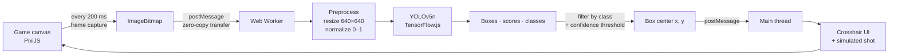

# Duck Hunt ML — AI Edition 🦆🎯

A browser duck-hunting game where **the player is an AI**. Instead of a human aiming with the mouse, a
**YOLOv5n object-detection model running on TensorFlow.js** watches the game screen in real time, finds the
ducks, and pulls the trigger on its own.

This project was built as part of a post-graduate program in Artificial Intelligence. Its goal is to show,
end to end, how a computer-vision model can be plugged into an interactive application: capturing frames,
running inference in the browser, turning detections into coordinates, and acting on them — all client-side,
with no backend and no server-side GPU.

---

## How it works



1. **Frame capture** — Every 200 ms the game stage is extracted from the PixiJS renderer as a canvas and
   converted into an `ImageBitmap`.
2. **Off-main-thread inference** — The bitmap is *transferred* (not copied) to a Web Worker, so the model never
   blocks rendering or game logic.
3. **Preprocessing** — Inside the worker, `tf.browser.fromPixels` turns the image into a `[H, W, 3]` tensor,
   which is resized with bilinear interpolation to the model's `640×640` input, normalized to `[0, 1]` and
   given a batch dimension. Everything runs inside `tf.tidy()` so intermediate tensors are released and memory
   doesn't leak between frames.
4. **Detection** — The YOLOv5n graph model returns bounding boxes, confidence scores and class indices
   (COCO's 80 classes).
5. **Post-processing** — Detections below the confidence threshold are dropped, and only the target class is
   kept. The COCO dataset has no "duck" class, and the pixel-art ducks are picked up by the model as **`kite`**,
   so that is the class the AI hunts. Each box is scaled back to screen space and reduced to its center point.
6. **Action** — The main thread converts the prediction into game coordinates and fires a shot exactly like a
   mouse click would, so the AI plays by the same rules as a human: same bullets, same blast radius, same
   timer.

### Why these choices

| Choice | Reason |
| --- | --- |
| **YOLOv5n** (nano) | Smallest YOLOv5 variant (~7 MB of weights): fast enough for real-time inference in a browser tab. |
| **TensorFlow.js** | Runs the model directly in the browser, using the GPU (WebGL backend) when available — no Python, no server. |
| **Web Worker** | Keeps inference off the main thread so the game keeps a smooth frame rate. |
| **Transferable `ImageBitmap`** | Sends frames to the worker without copying pixel buffers. |
| **`tf.tidy()` + explicit `dispose()`** | Prevents GPU/CPU memory from growing with every inference. |
| **Model warm-up** | A dummy inference at startup initializes the backend, so the first real frame isn't slow. |

---

## Visual feedback

The game UI was modernized so you can follow what the AI is doing, while keeping the original pixel-art look:

- **AI status panel** — shows when the model is loading, scanning, or has locked on a target with its
  confidence and coordinates.
- **Smooth AI crosshair** — glides between predictions instead of jumping every 200 ms and changes color by
  confidence (green ≥ 70%, yellow ≥ 50%, orange below).
- **Shot feedback** — impact ring showing the blast radius, particles and a floating score popup on hits.
- **Modern HUD** — translucent panels, pill buttons and crisp text; sprites use nearest-neighbor scaling so
  the pixel art stays sharp at any window size.

> The crosshair and AI panel are drawn on a separate layer outside the captured game stage, so the model never
> "sees" its own UI and can't be confused by it.

---

## Tech stack

- **[TensorFlow.js](https://www.tensorflow.org/js)** — in-browser ML inference
- **[YOLOv5](https://github.com/ultralytics/yolov5)** (nano, COCO-pretrained, exported to TF.js graph model) — object detection
- **[PixiJS 8](https://pixijs.com/)** — WebGL rendering
- **[GSAP](https://gsap.com/)** — animations and tweens
- **[Howler.js](https://howlerjs.com/)** — audio
- **Webpack 5 + Babel** — bundling and transpiling

---

## Getting started

**Requirements:** [Node.js](https://nodejs.org/) 20+ and a modern browser with WebGL.

```bash
git clone git@github.com:magnosith/DuckHunt-ML.git
cd DuckHunt-ML
npm install
npm start
```

Open http://localhost:8080. The game starts right away; once the model finishes loading (a few seconds on
first load), the status panel switches to *scanning* and the AI starts shooting.

> The project must be served over HTTP (`npm start`). Opening `dist/index.html` via `file://` fails because
> the model and sprites are loaded with `fetch`. An internet connection is also needed, since the worker loads
> TensorFlow.js from the jsDelivr CDN.

### Scripts

| Command | What it does |
| --- | --- |
| `npm start` | Dev server with live reload at http://localhost:8080 |
| `npm run build` | Builds the bundle into `dist/` |
| `npm run lint` | Runs ESLint over `src/` |
| `python3 scripts/pack_sprites.py` | Rebuilds `dist/sprites.png` + `sprites.json` from `src/assets/images` (requires [Pillow](https://pypi.org/project/pillow/)) |

---

## Tuning the AI

The main knobs live in `machine-learning/`:

| Setting | File | Default | Effect |
| --- | --- | --- | --- |
| `CLASS_THRESHOLD` | `worker.js` | `0.4` | Minimum confidence to act on a detection. Higher = fewer false shots, but more missed ducks. |
| Target label | `worker.js` | `'kite'` | COCO class treated as a duck. |
| `INPUT_MODEL_DIMENTIONS` | `worker.js` | `640` | Model input size; must match the exported model. |
| Capture interval | `main.js` | `200` ms | How often a frame is sent for inference. Lower = faster reactions, more GPU load. |

Some ideas to push accuracy further:

- **Fine-tune YOLO on game frames** labeled with a dedicated `duck` class instead of relying on `kite`.
- **Lead the target** — use the motion between consecutive predictions to aim where the duck *will be*.
- **Track across frames** to avoid wasting bullets on the same duck twice.

---

## Project structure

```
DuckHunt-ML/
├── main.js                     # Entry point: boots the game, then the AI player
├── machine-learning/
│   ├── main.js                 # Frame capture loop, worker messaging, simulated shots
│   ├── worker.js               # TensorFlow.js + YOLOv5n inference (Web Worker)
│   ├── layout.js               # AI crosshair and status panel (UI layer)
│   └── yolov5n_web_model/      # Model graph, weight shards and COCO labels
├── src/
│   ├── modules/                # Game, Stage, Hud, Duck, Dog, Effects…
│   ├── data/levels.json        # Level definitions
│   └── assets/                 # Source images and sounds
├── scripts/pack_sprites.py     # Spritesheet packer
└── dist/                       # Built bundle, spritesheet and audio served by the dev server
```

---

## Credits

This project is a fork of **[DuckHunt-JS](https://github.com/MattSurabian/DuckHunt-JS)** by
**[Matt Surabian](https://github.com/MattSurabian)**, released under the [MIT License](LICENSE). The original
game engine, gameplay, assets pipeline and level creator are his work — the AI player, the machine-learning
pipeline and the visual updates were added on top of it.

- YOLOv5 by [Ultralytics](https://github.com/ultralytics/yolov5), trained on the [COCO dataset](https://cocodataset.org/).
- Duck Hunt is a trademark of Nintendo. This is a non-commercial educational project and is not affiliated with
  or endorsed by Nintendo.
